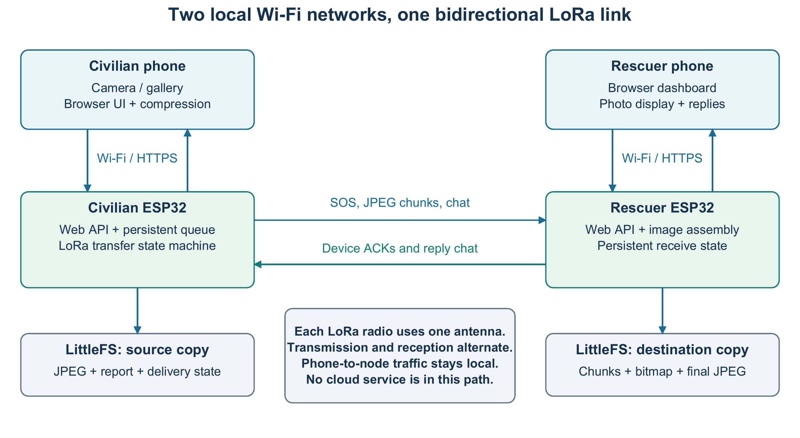
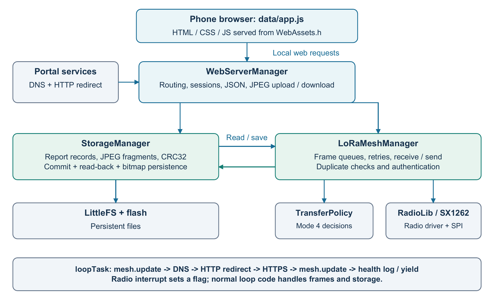
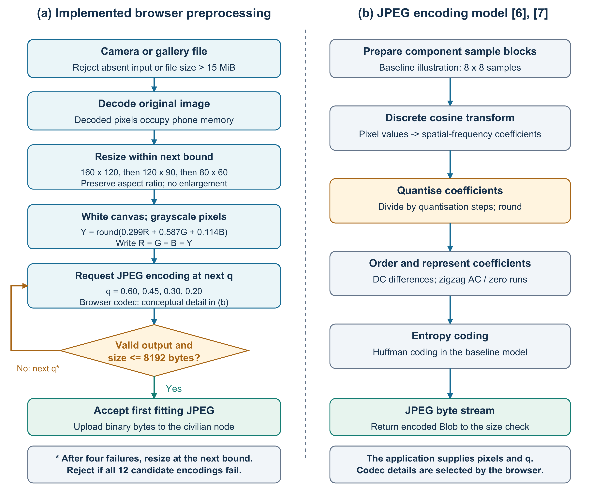
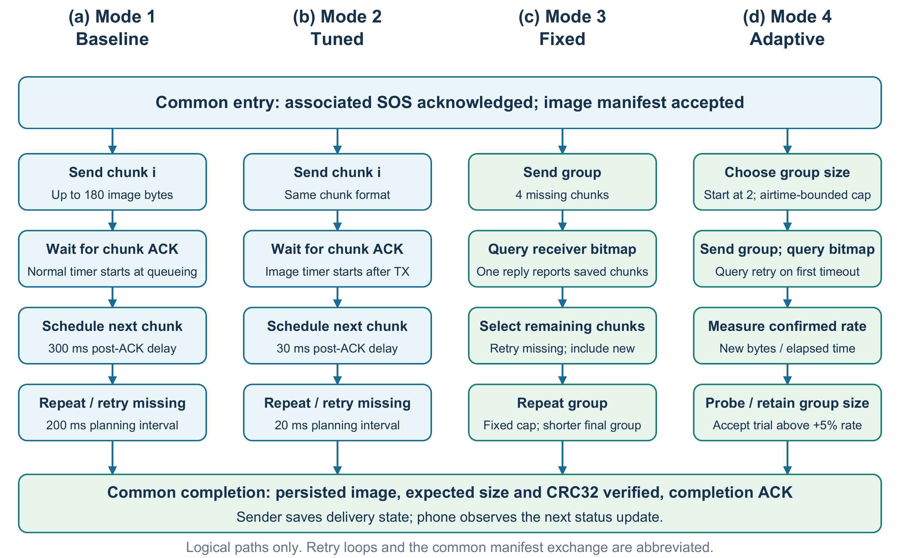
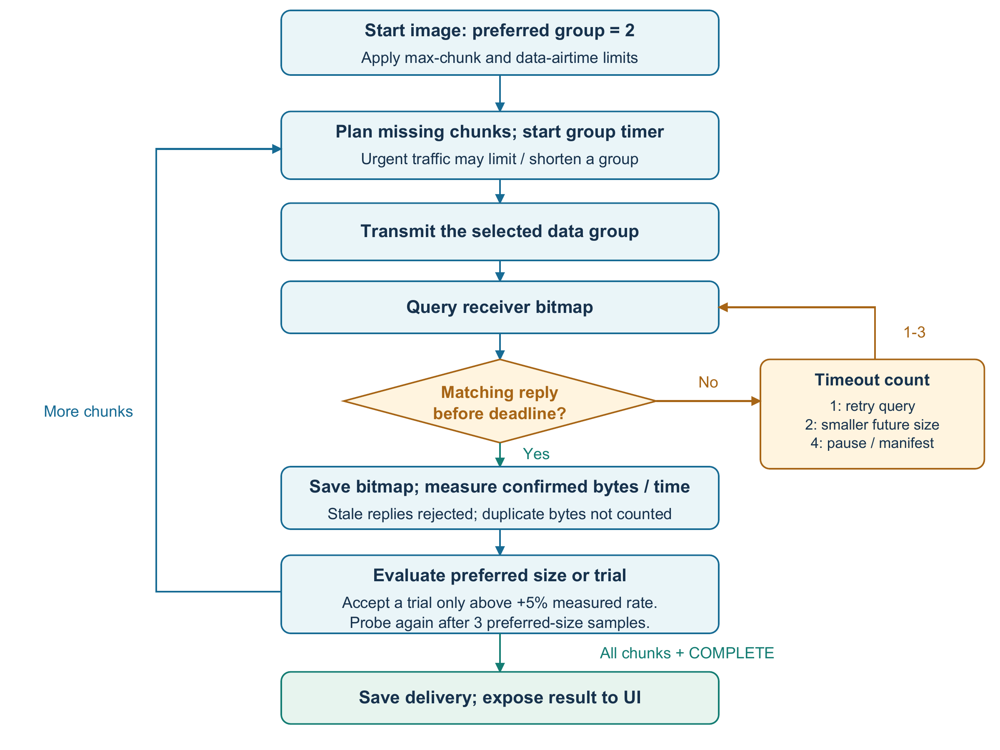

## III. METHODOLOGY

### A. Research Design and Rationale

We developed an offline communication prototype for transmitting SOS reports, location information, photographs and two-way text messages between civilian and rescuer nodes. Our experimental research question is: **How do scheduling changes, acknowledgement aggregation and adaptive group selection affect receiver-observed image-reception time on an ESP32-based LoRa link?**

Recent IEEE research addresses different sources of image-transfer overhead. Onykiienko et al. combine Haar-wavelet preprocessing with JPEG on an ESP32-CAM [1]. De et al. alternate transmissions between two frequencies and receivers to reduce reception delays [2]. Torres et al. investigate multi-packet image transmission [3], while Chen et al. establish batching, bit-vector acknowledgements and selective retransmission [4]. These approaches motivate examining compression, hardware and acknowledgement behaviour separately: reducing image bytes and adding receiving hardware can both change delivery time independently of the transport policy.

The present prototype retains one LoRa transceiver per node and compares four transport configurations using identical compressed payloads. Its candidate contribution is the integration of measured-goodput group selection, acknowledgement recovery and urgent-traffic scheduling within this resource-constrained architecture. JPEG compression and bitmap acknowledgements are established techniques; their inclusion alone does not establish originality. The evaluation therefore targets the additional effect of the implemented adaptive policy over fixed grouping.

Our primary comparison is adaptive transfer against fixed-group transfer. We hypothesise that the adaptive policy can reduce image-reception time under the evaluated conditions. We recorded five individual timings per mode using the same image and calculated the descriptive statistics from these measurements. Obstruction testing is planned, and our distance observations are currently qualitative. Reliability and urgent-message responsiveness are design considerations whose performance has not been established by these timings.

### B. System and Software Architecture

We used two Heltec WiFi LoRa 32 V3 boards, each containing an ESP32-S3 controller and an SX1262 LoRa transceiver. One board serves the civilian interface and the other the rescuer interface. Integrating Wi-Fi and LoRa on each board supports local phone access and inter-node communication without a separate gateway. Each transceiver uses one antenna for alternating transmission and reception. We used a direct two-node link to examine the transfer policy without introducing relay scheduling or route changes as additional variables. The web interface avoids a dedicated phone application or an Internet connection; the node serves its interface locally.

Figure 1 separates the phone-to-node web connection from the inter-node radio connection and identifies the persistent source and destination copies.

**Fig. 1.** System architecture and data paths. The phones run the web interfaces; the ESP32 nodes perform persistent storage and LoRa transfer. The current web server uses HTTPS with HTTP redirection. Original diagram derived from the project implementation.

Figure 2 decomposes the software into browser processing, web services, persistent storage and radio transport. The browser executes the interface and image preparation using the phone's processor and memory. The ESP32 serves the interface assets from flash, validates requests through `WebServerManager`, maintains records and image fragments through `StorageManager`, and schedules radio traffic through `LoRaMeshManager`. `TransferPolicy` supplies the adaptive decisions, while RadioLib controls the SX1262. Both roles use this shared structure; their interfaces and permissions determine whether users originate SOS reports or review reports and send replies.

**Fig. 2.** Software components and execution context. Browser code executes on the phone. Web handlers, storage operations and radio processing share the firmware's application loop; the radio interrupt records an event for subsequent processing. Original diagram derived from the implementation.

The application loop services the mesh before and after the DNS, HTTP-redirect and HTTPS handlers. Long image-upload and download handlers also service the mesh between buffer operations. These service points give radio processing opportunities while the phone accesses the portal. We use a 16 KiB application-task stack to accommodate the combined web, storage and mesh call path after stack exhaustion occurred with the default 8 KiB stack during development. The larger stack consumes additional RAM; minimum free stack, heap and service-time diagnostics support monitoring this trade-off. Cooperative service can still delay radio processing during a long handler.

The civilian node saves the SOS before accepting its photograph. Image preparation can therefore proceed while the report is awaiting acknowledgement. Radio transmission of the photograph begins only after the associated SOS has an acknowledged destination. The receiver writes and reads back each chunk before persisting its reception bit. Image completion requires the expected byte count, JPEG boundary-marker checks, CRC32 verification and saved completion state. The sender marks delivery after the destination's completion acknowledgement. The dashboard subsequently reads this state through periodic polling, so device-confirmed delivery and visible interface updates have distinct timing boundaries.

We give the SOS precedence because a failed or slow photo upload should not prevent the short emergency report from being saved. Persisting each chunk before acknowledging it ties feedback to stored progress. CRC32 checks the assembled bytes, while length and JPEG marker checks detect incomplete or malformed output; none of these checks establishes that the scene is useful for rescue decisions. LittleFS provides local persistence without another storage device, at the cost of flash-write latency. We keep this persistence procedure common to the four modes so acknowledgement grouping does not also change the storage guarantee.

**TABLE I — CONTROLLED HARDWARE AND SOFTWARE PARAMETERS**

| Parameter | Value or control | Rationale |
| --- | --- | --- |
| Nodes and topology | One civilian and one rescuer; direct link | Isolate the transfer-mode comparison from relay behaviour |
| Platform | Heltec WiFi LoRa 32 V3; ESP32-S3; SX1262 | Provide local Wi-Fi access and LoRa on the same board |
| Frequency / bandwidth | 915 MHz / 125 kHz | Retain the configured radio profile across modes |
| Spreading factor / coding rate | SF9 / 4/7 | Hold modulation and error-correction overhead constant |
| Transmit power / preamble | 22 dBm / 8 symbols | Avoid changing transmit-power and acquisition settings between modes |
| Image limit / full chunk payload | 8192 bytes / 180 bytes | Bound transfer size and fit data plus metadata within a radio frame |
| Wi-Fi access | Open access point; channel 6 | Reduce connection steps and retain the same local portal setup |
| Persistent storage | LittleFS; persist each chunk | Acknowledge stored progress consistently across modes |
| Firmware identity | Source revision, mode and role | Make configuration differences traceable |
| Physical controls | Fixed equipment and placement within a comparison | Reduce changes in the radio path unrelated to the transfer mode |

Table I records the current configuration. Actual startup settings, board identities, antenna details, separations and placement will be retained with the trial data. All participating nodes will use the same mode during a trial; modes 1–2 use wire protocol 3, while modes 3–4 use wire protocol 4.

The exact radio values are retained implementation settings, not an experimentally optimised operating point. Keeping them fixed is justified because bandwidth, spreading factor and coding rate can change transmission time independently of the acknowledgement policy [4]. Similarly, channel 6 and 22 dBm are controls for this comparison, not findings about the best Wi-Fi channel or minimum required radio power. Matching the mode on both boards is necessary because the grouped modes use different frame types and protocol versions.

### C. Image-Compression Architecture

#### 1) Processing location and design rationale

The image pipeline is executed by JavaScript in the civilian phone's browser. The node receives an already encoded JPEG, which avoids decoding a full-resolution photograph on the ESP32. This allocation is suited to the prototype's separation between a phone-based camera interface and a radio node responsible for persistence and delivery. Dede et al. examine JPEG compression for LoRa image transfer [5], and the more recent wavelet–JPEG method in [1] further illustrates the trade-off between payload size, processing and reconstructed image quality. The implemented pipeline uses resizing, grayscale conversion and browser JPEG encoding; it introduces no wavelet stage or learned codec.

Figure 3 distinguishes application-controlled preprocessing from the browser's JPEG encoder. The former determines the candidate dimensions, pixel values, quality requests and byte limit. The latter generates the compressed byte stream. The 8192-byte limit is a prototype storage and transfer constraint rather than an intrinsic LoRa image-size limit.

**Fig. 3.** Image-compression architecture: (a) implemented preprocessing and bounded candidate search; (b) an explanatory baseline JPEG model based on [6], [7]. Panel (b) describes codec principles, not an independently implemented encoder. The browser selects its encoding details. All candidate images originate from the decoded source photograph.

#### 2) Input decoding and spatial reduction

The function rejects an absent file or an encoded input larger than 15 MiB. This admission limit prevents arbitrarily large uploads from entering the preparation path; it is not a measured safe decoding-memory threshold. It then decodes the source image before resizing. For source dimensions \(W\times H\) and candidate bound \((B_w,B_h)\), the scale and output dimensions are

\[
s=\min\left(\frac{B_w}{W},\frac{B_h}{H},1\right),\qquad
w=\max(1,\operatorname{round}(sW)),\quad
h=\max(1,\operatorname{round}(sH)). \tag{1}
\]

The ordered bounds are \((160,120)\), \((120,90)\) and \((80,60)\). Equation (1) retains the aspect ratio subject to integer rounding and prevents enlargement. Thus, a 4000 × 3000 source produces a 160 × 120 candidate, whereas a 3000 × 4000 portrait produces 90 × 120. These are bounding rectangles rather than forced output resolutions. Resampling is delegated to the browser's canvas implementation; the application does not specify a custom interpolation filter. Reducing pixel count limits the information available to the subsequent encoder, with an associated risk of removing small objects and fine text.

We use the minimum of the width and height scale limits because both constraints must hold simultaneously. The additional limit of one prevents enlargement, which would add pixels without adding captured detail. Integer rounding produces valid pixel dimensions, and the lower bound of one prevents an empty canvas. The three decreasing bounds provide a small, finite set of spatial fallbacks when JPEG quality reduction alone cannot meet the byte limit; their exact values are implementation choices whose visual adequacy still requires assessment.

The canvas is filled with white before the image is drawn, establishing a defined background for transparent input. Each pixel is then converted using

\[
Y=\operatorname{round}(0.299R+0.587G+0.114B),\qquad
(R',G',B')=(Y,Y,Y). \tag{2}
\]

Here, \(R,G,B\) are the canvas's colour-channel values. Equation (2) produces a luma-like grayscale value; it is not a measurement of physical luminance. Equal channel values remove colour distinctions, which may discard useful scene information. The canvas still stores RGBA pixels, and the application does not require the JPEG encoder to emit a single-component grayscale file. Consequently, neither a threefold memory reduction nor a fixed compression benefit can be inferred from grayscale conversion alone.

We use a fixed weighted conversion to obtain a reproducible grayscale representation with constant work per pixel. The coefficients emphasise green and sum to one, preserving an already neutral pixel where \(R=G=B\). The same weighted conversion is examined by Stracke et al. [8] as an established approximation to relative brightness sensitivity. Rounding returns an integer channel value. We use grayscale to remove colour variation before encoding; its byte-saving effect and the acceptability of lost colour cues remain empirical questions for our photographs.

#### 3) Transform coding and quantisation

The discrete cosine transform (DCT) represents samples using cosine basis functions [6]. In the two-dimensional block formulation, the coefficient array is

\[
F=A f A^{\mathsf T},\qquad
A_{u,x}=\alpha_u\cos\left[\frac{(2x+1)u\pi}{16}\right], \tag{3}
\]

where \(x,u\in\{0,\ldots,7\}\), \(\alpha_0=1/\sqrt{8}\) and \(\alpha_u=1/2\) for \(u>0\). The matrix \(f\) contains an 8 × 8 block of centred samples. The transform exposes slowly varying content in low-frequency coefficients and finer variation in higher-frequency coefficients. It changes the representation of 64 samples into 64 coefficients; the transform alone does not reduce the number of coefficients or guarantee fewer bytes [6].

Equation (3) explains the transform used by the baseline JPEG model. The row and column transforms are separable, while the normalisation factors make the basis orthonormal. Concentrating correlated image content into fewer large coefficients makes subsequent quantisation useful [6], [7]. We describe the 8 × 8 formulation because it is part of JPEG's established coding structure, not a block size independently optimised by our application.

In the explanatory baseline JPEG model, eight-bit samples are centred by subtracting 128, transformed in blocks and quantised [7]:

\[
\widehat F_{u,v}=\operatorname{round}\left(\frac{F_{u,v}}{Q_{u,v}}\right). \tag{4}
\]

The positive quantisation step \(Q_{u,v}\) controls rounding precision. Larger steps can turn small coefficients into zeros and remove detail. DC differences, zigzag ordering of AC coefficients and zero-run representation prepare the quantised values for Huffman coding in the baseline model. Decoding reverses the coding and transform stages but cannot recover information removed by quantisation [7].

We include Eq. (4) because it identifies the lossy step that trades image detail for fewer encoded bits. Division expresses a coefficient in quantisation-step units, and rounding selects the nearest representable level. Zero coefficients can then be represented compactly. This explains why changing JPEG quality can alter file size without changing pixel dimensions; our browser controls the quantisation tables [7].

The application delegates these codec operations to `canvas.toBlob()` with the MIME type `image/jpeg`. It does not set quantisation matrices, component sampling, entropy tables or sequential/progressive encoding. Accordingly, Fig. 3(b) explains JPEG's compression mechanism without asserting that a particular browser uses every illustrated baseline choice. The supplied quality parameter is an encoder request, not a percentage of original quality or a target compression ratio.

#### 4) Bounded search and acceptance condition

At each dimension bound, the application requests JPEG encodings with quality values \(q\in(0.60,0.45,0.30,0.20)\), in that order. It returns the first non-null output satisfying \(|J|\leq8192\) bytes. If all four values fail, it constructs the next smaller canvas and repeats. There are at most twelve encoding attempts; failure of every candidate raises an image error while the independently saved SOS remains available.

This ordering prioritises the larger permitted dimensions before reconsidering spatial size. For example, an acceptable 160 × 120 candidate at \(q=0.20\) is selected before testing 120 × 90 at \(q=0.60\). The procedure therefore provides a bounded first-fit search, not optimisation of perceived quality. Each dimension candidate is drawn from the decoded original, and each quality candidate is encoded from its grayscale canvas. The application does not repeatedly decode and recompress its own intermediate JPEG outputs.

The descending quality sequence attempts to preserve the highest requested quality at each spatial bound, while the first-fit rule limits preparation to twelve candidates. We test actual output bytes because a browser quality request does not specify file size. The 8192-byte cap bounds storage and the maximum number of chunks; with 180-byte chunks, its 46 reception bits fit in the implementation's 64-bit bitmap. The chosen quality steps and byte cap are practical bounds, not validated optima for scene recognition or compression rate.

The accepted file is uploaded as binary JPEG bytes, avoiding the size expansion of a text encoding. We used the same 2284-byte image in the four-mode experiment. Keeping the image common prevents different scene content or compressed sizes from explaining the timing differences. JPEG hashes will be added to subsequent trial records to verify byte identity; the present record contains the byte count but no hash.

#### 5) Memory, packetisation and fidelity

The output limit bounds transmitted JPEG data, but it does not bound the phone's decoding memory. As an illustrative calculation, one four-byte RGBA representation of a 4000 × 3000 image occupies 48,000,000 bytes, approximately 45.8 MiB. A 160 × 120 canvas occupies 76,800 bytes, or 75 KiB, under the same representation. Additional decoder and browser buffers can coexist. Since original-image decoding precedes resizing, a small final JPEG does not exclude memory pressure during photo selection; these figures describe buffer sizes rather than measured peak memory.

For a JPEG of \(B\) bytes, fragmentation produces

\[
N=\left\lceil\frac{B}{180}\right\rceil. \tag{5}
\]

We use the ceiling because any remaining bytes require a final partial chunk; rounding down would omit data. The divisor is the actual 180-byte application payload, not the radio frame length. This payload leaves room for the header, chunk metadata and authentication tag inside the 255-byte frame limit. Its purpose is predictable fragmentation with fixed overhead across modes; the experiment does not establish that 180 bytes is the best payload size.

An 8192-byte file therefore requires 46 chunks. Each full chunk contains 180 image bytes, a three-byte chunk prefix, a 39-byte protocol header and an eight-byte authentication tag, giving 230 bytes supplied to the radio. Compression reduces the number of data frames; grouping reduces acknowledgement exchanges. They affect different contributors to delivery time. At the configured radio parameters, the firmware airtime model gives approximately 1.574 s per full chunk. An 8192-byte transfer contains 45 full chunks and one shorter chunk, giving approximately 71.8 s of data-frame airtime before manifests, acknowledgements, listening intervals or retransmissions. This is a calculated example, not an observed delivery result.

The airtime calculation counts encoded symbols and multiplies by symbol duration: \(\tau=(N_{\mathrm{preamble}}+4.25+N_{\mathrm{payload}})2^{SF}/BW\), with \(BW\) in hertz and \(\tau\) in seconds. Our firmware includes the explicit header, physical-layer CRC and coding-rate expansion when calculating \(N_{\mathrm{payload}}\). For a full frame at SF9 and 125 kHz, the symbol duration is 4.096 ms and the payload comprises 372 symbols; \((8+4.25+372)\times4.096=1573.888\) ms, rounded upward to 1574 ms by the firmware. We use this estimate for scheduling because a sender cannot receive during its own transmission. It excludes software waiting and retries.

Fidelity will be examined separately from transfer correctness. For the compression assessment, the decoded JPEG will be compared with its unencoded grayscale canvas at the same dimensions. For eight-bit grayscale samples, PSNR will be calculated as \(10\log_{10}(255^2/\mathrm{MSE})\), with MSE averaged over all corresponding pixels. Structural similarity (SSIM), which assesses changes in luminance, contrast and structure [9], will use an 11 × 11 Gaussian window, standard deviation 1.5, dynamic range 255, and constants \(K_1=0.01\) and \(K_2=0.03\). Gaussian-weighted population moments will be used, and only windows fully inside the image will be averaged. This comparison isolates JPEG distortion after preprocessing; it does not measure detail removed by resizing or colour removal. Original and reconstructed images will therefore also be shown together at a documented display scale, with losses of small features and colour cues discussed explicitly. Byte-perfect delivery establishes preservation of the selected JPEG, not preservation of the original photograph or proven usefulness for rescue decisions.

PSNR expresses squared pixel error relative to the maximum eight-bit value of 255 on a logarithmic scale. Squaring avoids cancellation of positive and negative errors; averaging makes the error comparable across equal-resolution images. SSIM complements this pixel-error measure by examining local structure [9]. Its stated window and constants follow the reference implementation choices in [9], which supports reproducibility rather than claiming these parameters are optimal for our images. Comparing equal-size grayscale references isolates JPEG distortion. These quality measurements remain planned and do not contribute to the current timing results.

### D. Comparative Transport Configurations

Table II defines the independent variable. The application, prepared JPEG bytes, storage operations and radio parameters will remain common to all modes. Mode 3 is the closest operational baseline for isolating the effect of the combined adaptive policy.

We include mode 1 as the original reference, mode 2 to examine reduced waiting while retaining stop-and-wait, mode 3 to examine grouped acknowledgements, and mode 4 to examine adaptation beyond fixed grouping. This progression provides more information than comparing only the slowest and fastest versions. It compares complete configurations, so it does not isolate every changed constant individually.

**TABLE II — TRANSPORT CONFIGURATIONS**

| Mode | Acknowledgement and scheduling behaviour | Purpose |
| --- | --- | --- |
| 1: Baseline | Stop-and-wait; 300 ms delay after image acknowledgements; 200 ms planning interval; normal retry deadline is queue time + 15 s + 0–1999 ms jitter | Original transport reference |
| 2: Tuned | Stop-and-wait; 30 ms post-ACK delay; 20 ms planning interval; reduced image scheduling jitter; timeout based on airtime and estimated path length, armed after transmission | Assess timing and scheduling improvements |
| 3: Fixed | Four image chunks per group, followed by a bitmap query and reply; resend only chunks still missing | Assess acknowledgement aggregation |
| 4: Adaptive | Variable groups, measured-goodput selection, query retry before group reduction, and adaptive acknowledgement timeout | Evaluate the proposed combined policy |

A bitmap represents the receiver's committed chunks. Group replies identify the corresponding request, allowing the sender to reject stale acknowledgements. Grouped data frames have a minimum 200 ms listening interval on the direct link, with additional forwarding allowances on longer paths. Selective retransmission and final image verification retain the same destination-completion condition despite fewer acknowledgement exchanges.

Bitmap feedback compactly identifies missing chunks, allowing selective retransmission rather than resending an entire image [4]. A fixed group of four provides a reproducible middle-sized baseline with feedback after a few chunks; it was not selected through an exhaustive group-size search. The listening intervals provide opportunities to receive control traffic between data frames on the half-duplex radio. Mode 2's shorter scheduling delays reduce intentional idle time, while mode 1 retains the original timing reference. Exact delays are implementation settings whose optimality has not been established by these trials.

Figure 4 compares the four software paths. Modes 1 and 2 send a chunk and await its individual acknowledgement before advancing. Mode 3 sends up to four missing chunks before querying the receiver's bitmap. Mode 4 retains the grouped exchange while choosing the group size from observed delivery rate. Each received chunk is still persisted individually; the grouped modes aggregate acknowledgements rather than flash writes. SOS and chat use their own acknowledged message exchanges, so the four image-transfer configurations do not imply four independent chat protocols.

**Fig. 4.** Software paths for (a) baseline stop-and-wait, (b) tuned stop-and-wait, (c) fixed groups and (d) adaptive groups. The common entry and completion conditions preserve destination-confirmed delivery. Retry paths are abbreviated; the arrows are not a timing scale. Original diagram derived from the implementation.

### E. Adaptive Group Selection and Recovery

Mode 4 begins with two chunks per group. For each eligible group, the sender estimates useful delivery rate as

\[
g=\frac{B_{\mathrm{new}}}{\Delta t}, \tag{6}
\]

where *B_new* is the number of newly confirmed image bytes and *Δt* is the elapsed time in seconds from group planning until the sender saves its bitmap reply, giving \(g\) in bytes per second. The firmware converts its millisecond interval using a factor of 1000. This interval includes queueing, packet transmission, listening gaps, retransmissions and acknowledgement waiting. Previously acknowledged bytes do not contribute again.

We use Eq. (6) because our objective is useful delivery per unit elapsed time, rather than bytes transmitted regardless of reception. Counting only newly confirmed bytes prevents duplicate retransmissions from increasing the score; counting actual bytes also handles a shorter final chunk. Including acknowledgement waiting penalises a group size that sends quickly but receives slow or unreliable feedback. This online policy measurement is distinct from the manually timed receiver-side interval used in the experiment.

The policy measures its preferred group size and probes a larger or smaller size by doubling or halving it within configured limits. A trial replaces the preferred size only when its measured rate exceeds the preferred rate by more than 5%. The preferred estimate is updated using weights of 0.75 for the previous estimate and 0.25 for the new sample. The first eligible sample initiates a probe; subsequent probes normally follow three preferred-size samples. A successful upward probe without missing chunks can initiate another upward probe immediately, within the cap. A bitmap indicating missing chunks prompts a smaller trial.

Starting at two chunks permits aggregation while obtaining feedback before a long initial group. Doubling or halving explores candidate sizes with few probes, at the cost of skipping intermediate sizes. The weighted update, \(\hat g_k=0.75\hat g_{k-1}+0.25g_k\), retains recent history while responding to a new measurement; its weights sum to one so it remains a rate estimate. The 5% acceptance margin discourages switching for small differences, and the three-group interval limits probe overhead. These constants define our heuristic policy; they are neither statistical-significance thresholds nor values shown to be optimal by a parameter sweep.

The group limit is

\[
W_{\max}=\min\left(8,\max\left(1,\left\lfloor\frac{8000}{\tau_{\mathrm{chunk}}}\right\rfloor\right)\right), \tag{7}
\]

where *τ_chunk* is the calculated airtime of a full chunk frame in milliseconds. The 8 s bound applies to data airtime; listening intervals and acknowledgements add elapsed time. With the current frame format and radio settings, the calculated limit is five full chunks. Therefore, eight is a configured ceiling rather than the group size used in every experiment.

The floor in Eq. (7) selects a whole number of full frames within the data-airtime budget. The outer minimum enforces the configured eight-chunk ceiling, while the lower bound of one permits progress when a frame is long. A frame longer than the budget would itself exceed 8 s; this is a scheduling bound rather than a universal hard deadline. The budget limits long data groups that postpone feedback, but its exact value is a design choice requiring sensitivity testing. At the present settings, \(\lfloor8000/1574\rfloor=5\), so the relevant cap is five, not eight.

After one unanswered bitmap request, the sender repeats the query while preserving the group size. Two consecutive unanswered requests reduce the preferred size for future groups while continuing query recovery for the current group. Four unanswered requests lead to the existing retry pause and manifest recovery. The acknowledgement timer uses smoothed request–reply delay and delay variation, subject to a path/airtime floor and a 60 s ceiling.

A missing reply does not identify whether data or feedback was lost, so repeating the query first can recover the receiver's saved bitmap without immediately shrinking the data group. Repeated silence triggers a more conservative group and eventually recovery, limiting repeated queries without progress. The timeout floor allows for physical transmission and forwarding time; smoothing reduces dependence on a single delayed reply, and backoff avoids immediately repeating failed exchanges. The retry counts and 60 s ceiling balance recovery opportunities against waiting and remain heuristic settings.

SOS and chat retain scheduling priority over images. An adaptive group can close at a packet boundary when urgent traffic arrives; an ongoing radio frame cannot be interrupted. Manifest replies, short final groups and groups interrupted by urgent traffic are excluded from policy training. Route changes or a receiver bitmap rollback reset the rate estimate. Learning starts afresh for each image, making image length and adaptation overhead relevant experimental factors.

We exclude these atypical groups from training because their duration or size is constrained by setup, image completion or urgent traffic rather than the selected group size. Resetting after a changed route or receiver state prevents applying a rate estimate to a different path or reception state. Prioritising SOS and chat reflects the need to transmit short emergency information during a longer image transfer; it does not establish a measured latency guarantee.

Figure 5 summarises the sender's adaptive data-group path. The common manifest exchange and destination image-verification requirements remain part of the grouped transport described above.

**Fig. 5.** Adaptive group selection and acknowledgement recovery. The first unanswered request retries the bitmap query. Further timeouts can reduce the preferred size for later groups or invoke manifest recovery. The diagram represents software decisions, not measured packet timing.

### F. Experimental Procedure

We evaluated all four transfer modes using the same 2284-byte compressed JPEG. We positioned the boards side by side and recorded five timings per mode, giving 20 measurements in total. The recorded durations were 94, 90, 95, 98 and 113 s for mode 1; 85, 89, 84, 83 and 88 s for mode 2; 75, 80, 77, 82 and 73 s for mode 3; and 58, 71, 75, 63 and 61 s for mode 4. We retained every reading in the analysis. Preliminary trials using different compressed images were excluded from this comparison because payload size would confound the transport-mode comparison.

The common image keeps scene content, compressed size and nominal chunk count constant. Side-by-side placement provides a stable initial geometry for comparing software modes, while limiting generalisation to weaker links. Five repetitions per mode give an initial estimate of variability without relying on one successful timing. Chen et al. also repeated individual measurements five times [4], providing a precedent for a small testbed study; this does not establish that five runs provide adequate statistical power for our effect size. We therefore treat the experiment as a preliminary descriptive comparison.

We started timing when the rescuer interface indicated reception and began receiving the image, and stopped when it displayed the photograph as complete and verified. We observed the initial receiving-side indication within approximately 3 s in every mode; this preceding interval was outside the image timer. Our experimental record contains the image byte count and manual timings, but not a JPEG hash, numerical side-by-side separation, trial order or per-run firmware logs. Table I documents the source configuration; these missing records limit independent reproduction of the exact setup.

The next planned experiment examines physical obstruction. The comparison will retain the prepared JPEG, radio settings, node roles and antenna placement while documenting the obstacle material, number of intervening walls or barriers, and node separation for each condition. An unobstructed comparison at a matched separation will help distinguish obstruction from distance. Conditions that require both position and obstruction changes will be reported as combined placement changes. Physical obstruction will not be assigned a packet-loss percentage or described as controlled radio interference without supporting measurements.

We include obstruction because the close-placement comparison does not exercise blocked propagation paths. Matching separation and other settings makes the barrier the intended changed condition; changing both separation and the barrier would prevent attributing a difference to either one alone. Recording failures as well as successful times prevents a method that completes only easy transfers from appearing uniformly fast. Rotating mode order reduces the chance that battery state, surrounding activity or elapsed test time systematically favours one mode.

We also checked all four modes at approximately 50–100 m with a clear path between the boards and observed broadly similar delivery behaviour. Our distance assessment is qualitative because per-distance timings, exact placements, repetition counts and unsuccessful attempts are unavailable for quantitative analysis. For subsequent obstruction trials, we will record the saved JPEG and byte count, timing method, node positions, pending traffic and final image state. We will retain individual times, rotate mode order, and document the repetition count and stopping rule before testing. Failed or unfinished transfers will remain in the trial record.

### G. Timing Definitions and Analysis

The primary measured quantity is the receiver-observed image-reception interval:

\[
T_{\mathrm{recv,UI}}=t_{\mathrm{complete\ and\ verified}}-t_{\mathrm{reception\ indication}}. \tag{8}
\]

We use Eq. (8) because our measured outcome is the time a rescuer waits for an incoming photo to become available with verified completion. Subtracting two observations from the same local timing process avoids synchronising the boards' clocks. The completion-and-verification indication provides a reproducible functional endpoint; stopping when reception merely starts would not establish that the whole image is available. Starting after the initial reception indication focuses this experiment on image reception rather than phone preparation and submission.

We observed both endpoints on the rescuer interface and timed the interval manually in seconds. The interval excludes the time before the reception indication, including earlier image preparation and submission activity. It ends at receiver completion, which need not coincide with the return of the final acknowledgement to the civilian. Manual reaction time and interface polling can affect both endpoints. We calculated the mean and sample standard deviation from the five individual timings for each mode:

\[
\bar T=\frac{1}{n}\sum_{i=1}^{n}T_i,\qquad
s=\sqrt{\frac{\sum_{i=1}^{n}(T_i-\bar T)^2}{n-1}},\qquad n=5. \tag{9}
\]

We use the arithmetic mean in Eq. (9) to give each recorded run equal weight and include the cost of slower completions. Sample SD shows how much individual times vary around that mean, which the mean alone cannot reveal. Squaring prevents positive and negative deviations from cancelling; the square root returns the result to seconds. Estimating the mean from the same observations leaves \(n-1\) degrees of freedom, giving a denominator of four. Under independent sampling from a common distribution with finite variance, this correction makes the sample variance \(s^2\) unbiased; it does not make \(s\) itself unbiased or establish independence of these trials. We use SD descriptively, not as a confidence interval, stopwatch accuracy or significance test. Retaining the 113 s run ensures the summary includes the observed slow completion.

For future logged trials, the sender's image `START` to final `DELIVERED` interval would instead measure sender-confirmed delivery, using the sender's millisecond clock. A first image `TX_START` to `DELIVERED` interval would provide another timing boundary. Neither log-based measure is substituted for Eq. (8), and none of these elapsed intervals represents radio airtime alone.

We calculated the relative reduction in mean reception time as

\[
R_{a\rightarrow b}=100\frac{T_a-T_b}{T_a}\;\%. \tag{10}
\]

Equation (10) expresses saved time as a fraction of the reference-mode time, making the direction and denominator explicit. A positive value means a reduction; a negative value would indicate slower reception. We also report the absolute difference in seconds because the percentage alone hides the practical waiting time. For the main comparison, \(100(77.4-65.6)/77.4=15.2\%\). This is a reduction in mean elapsed time, not a percentage increase in radio bit rate.

Here, \(T_a\) is the calculated reference-mode mean and \(T_b\) is the calculated comparison-mode mean. The primary descriptive contrast is mode 4 against mode 3; comparison with mode 1 provides the overall baseline reduction. Percentages are calculated from the means, not averaged from paired per-run reductions. Run positions are not treated as matched pairs across modes because the acquisition order and pairing were not documented. Analysis is descriptive; no statistical-significance claim is made from this small dataset. No delivery-success probability is estimated because a complete record of successful and unsuccessful attempts is unavailable.

Our test image contains \(B=2284\) bytes. Dividing this count by the receiver-observed duration would describe an effective rate over that specific interface interval, rather than sender-confirmed protocol goodput. We therefore focus on reception time. We did not measure retransmission rate or radio airtime in these trials. Subsequent logged trials can additionally record retransmissions, acknowledgement timeouts and image-integrity checks. Calculated airtime will remain identified as an estimate. Obstruction and distance results will be grouped by their documented physical condition, with failures reported alongside successful durations.

### H. Validity, Reproducibility and Scope

Using a common 2284-byte image and five repetitions per mode reduces dependence on a different photograph or a single observation, but does not establish that all other conditions were controlled. The individual readings are preserved; missing payload hashes, firmware records and acquisition order still limit reproducibility. Manual timing may include reaction time and interface-update delay. Changes in pending traffic, storage state or antenna orientation may also affect duration. These factors have not been separately quantified. Five observations per mode provide a preliminary estimate of variation but limited evidence about performance across images, placements and repeated sessions.

Our results evaluate complete configurations. Separate ablation experiments would be required to attribute an improvement specifically to group selection or acknowledgement recovery. Without packet traces, we cannot separate the contributions of fewer exchanges, scheduling delays and retransmissions. We excluded the earlier unequal-payload observations from this comparison. Our conclusions apply to the tested image and session; the timings do not establish field-rescue effectiveness, long-range reliability, energy savings or immunity to interference.

## IV. RESULTS AND DISCUSSION

### A. Comparison Using the Same Image

Table III presents the means and sample standard deviations calculated from five runs per mode for the same 2284-byte image with the nodes side by side. At the configured 180-byte image payload per full chunk, this image requires 13 data chunks: twelve carrying 180 bytes and one carrying 124 bytes. This is a calculated fragmentation count, not a measurement of transmitted frames; retries and control traffic would add transmissions. The adaptive configuration produced the shortest mean, followed by fixed grouping, tuned stop-and-wait and baseline stop-and-wait.

**TABLE III — IMAGE-RECEPTION TIME FOR A 2284-BYTE JPEG, FIVE RUNS PER MODE**

| Mode | Transfer configuration | Mean ± sample SD (s) | Time saved relative to mode 1 (s) | Reduction relative to mode 1 (%) |
| --- | --- | ---: | ---: | ---: |
| 1 | Baseline stop-and-wait | 98.0 ± 8.86 | 0.0 | 0.0 |
| 2 | Tuned stop-and-wait | 85.8 ± 2.59 | 12.2 | 12.4 |
| 3 | Fixed groups with bitmap acknowledgements | 77.4 ± 3.65 | 20.6 | 21.0 |
| 4 | Adaptive group selection and acknowledgement recovery | **65.6 ± 7.13** | **32.4** | **33.1** |

*We recorded five timings per mode using the same 2284-byte image with the boards side by side. Timing ran from the rescuer's reception indication to its complete-and-verified image indication. SD denotes sample standard deviation, not a confidence interval. Every recorded value, including the 113 s mode 1 run, is included.*

Relative to mode 1, we measured a mean reduction of 12.2 s (12.4%) with mode 2. Mode 3 took a further 8.4 s less than mode 2, a reduction of 9.8% relative to the tuned configuration. Our primary comparison, mode 4 against mode 3, showed a mean reduction of 11.8 s, or 15.2%. Across the baseline and adaptive configurations, the mean difference was 32.4 s (33.1%).

The adaptive mode also showed greater variation than fixed grouping: its sample standard deviation was 7.13 s, compared with 3.65 s for mode 3. Their observed ranges were 58–75 s and 73–82 s, respectively. Thus, mode 4 was fastest on average in this dataset, but did not produce the most consistent timings. Mode 2 had the smallest sample standard deviation, 2.59 s. Mode 1 ranged from 90 to 113 s, with a sample standard deviation of 8.86 s; the longest run was retained because no measurement error was documented. The variation cannot be assigned to retransmissions or adaptation without corresponding logs.

### B. Interpretation and Relationship to IEEE Research

The mean ordering is consistent with the intended changes in protocol overhead. Mode 2 shortens scheduling and acknowledgement delays. Mode 3 aggregates reception feedback through bitmap acknowledgements. Mode 4 additionally selects group size from observed delivery rate and retries a missing bitmap response before reducing the preferred group size. This is an explanation suggested by the implementation; the elapsed times alone do not identify which exchanges or retries caused the differences.

Chen et al. [4] establish batched LoRa image transmission with bit-vector acknowledgements and selective retransmission. Torres et al. [3] also investigate multi-packet LoRa image transfer. These IEEE studies support acknowledgement aggregation as a relevant comparison, rather than an originality claim in itself. The present 15.2% difference between modes 3 and 4 concerns the additional combined adaptive behaviour within this prototype. It does not demonstrate superiority over either published system, whose payloads, hardware and evaluation conditions differ.

For the intended SOS application, a shorter image-transfer interval could make a photograph available to a rescuer sooner after the associated report. The measured outcome here remains communication time. No reduction in rescue-response time, energy consumption or failure probability has been measured. Repeated trials, packet traces and testing under obstruction are needed to establish the conditions under which the observed benefit persists or disappears.

### C. Distance Observations and Pending Obstruction Evaluation

We checked all four modes at approximately 50–100 m with a clear path between the boards and observed broadly similar delivery behaviour to the side-by-side comparison. This qualitative observation confirms operation at the checked placements, but per-distance timings, repeat counts and failure records are unavailable for a quantitative comparison. We therefore do not infer a distance-performance curve, maximum range or equivalence between placements. Table III contains the side-by-side measurements only.

With fixed radio settings and frame lengths, the firmware's nominal frame-airtime calculation is unchanged by separation. Similar total times could therefore occur at placements where reception remains adequate and retry counts remain similar. This is a possible explanation, not a finding established by the available measurements; packet traces and signal measurements would be needed to examine it.

We plan to evaluate physical obstruction by comparing delivery duration and unsuccessful attempts under documented conditions. Similar successful-transfer times would not by themselves establish equal reliability, because the proportion of failed or timed-out attempts must also be considered.

## ACKNOWLEDGMENT

We used OpenAI Codex to assist with software development, literature discovery, manuscript drafting, architecture diagrams and statistical summaries. We conducted the hardware experiments and recorded the measurements.

## REFERENCES

[1] Y. Onykiienko, S. Naida, M. Mazin, I. Kyrylenko, and P. Popovych, “An Efficient Image Compression Method for LoRa Networks,” in *2026 IEEE 8th International Conference on Smart Technologies in Power Engineering and Electronics (STEE)*, Kyiv, Ukraine, 2026, pp. TT2.14.1–TT2.14.5, doi: [10.1109/STEE63704.2026.11663995](https://doi.org/10.1109/STEE63704.2026.11663995).

[2] S. De *et al.*, “Interleaved Reception in LoRa Using IFT: A Hardware-Efficient Architecture for Fast and Low-Power Image Transmission,” *IEEE Internet of Things Journal*, vol. 12, no. 19, pp. 39777–39787, Oct. 2025, doi: [10.1109/JIOT.2025.3588064](https://doi.org/10.1109/JIOT.2025.3588064).

[3] J. Torres, M. Nunez, and J. M. Mauricio Villanueva, “LoRa Multi-Packet Protocol for Image Transmission,” in *2024 8th International Symposium on Instrumentation Systems, Circuits and Transducers (INSCIT)*, Joao Pessoa, Brazil, 2024, pp. 1–6, doi: [10.1109/INSCIT62583.2024.10693388](https://doi.org/10.1109/INSCIT62583.2024.10693388).

[4] T. Chen, D. Eager, and D. Makaroff, “Efficient Image Transmission Using LoRa Technology In Agricultural Monitoring IoT Systems,” in *2019 International Conference on Internet of Things (iThings) and IEEE Green Computing and Communications (GreenCom) and IEEE Cyber, Physical and Social Computing (CPSCom) and IEEE Smart Data (SmartData)*, Atlanta, GA, USA, 2019, pp. 937–944, doi: [10.1109/iThings/GreenCom/CPSCom/SmartData.2019.00166](https://doi.org/10.1109/iThings/GreenCom/CPSCom/SmartData.2019.00166).

[5] O. L. Dede, H. M. Jalajamony, and R. E. Fernandez, “Image Transmission over LoRa-Based Networks: A Performance Study Using Image Compression and Reconstruction Methods,” in *2024 IEEE 21st Consumer Communications & Networking Conference (CCNC)*, Las Vegas, NV, USA, 2024, pp. 642–643, doi: [10.1109/CCNC51664.2024.10454687](https://doi.org/10.1109/CCNC51664.2024.10454687).

[6] N. Ahmed, T. Natarajan, and K. R. Rao, “Discrete Cosine Transform,” *IEEE Transactions on Computers*, vol. C-23, no. 1, pp. 90–93, Jan. 1974, doi: [10.1109/T-C.1974.223784](https://doi.org/10.1109/T-C.1974.223784).

[7] G. K. Wallace, “The JPEG Still Picture Compression Standard,” *IEEE Transactions on Consumer Electronics*, vol. 38, no. 1, pp. xviii–xxxiv, Feb. 1992, doi: [10.1109/30.125072](https://doi.org/10.1109/30.125072).

[8] L. Stracke, L. Nimmermann, S. Agnihotri, M. Keuper, and V. Blanz, “Vision At Night: Exploring Biologically Inspired Preprocessing For Improved Robustness Via Color And Contrast Transformations,” in *Proceedings of the IEEE/CVF International Conference on Computer Vision Workshops*, 2025. [Author manuscript, version 1](https://arxiv.org/html/2509.24863v1).

[9] Z. Wang, A. C. Bovik, H. R. Sheikh, and E. P. Simoncelli, “Image Quality Assessment: From Error Visibility to Structural Similarity,” *IEEE Transactions on Image Processing*, vol. 13, no. 4, pp. 600–612, Apr. 2004, doi: [10.1109/TIP.2003.819861](https://doi.org/10.1109/TIP.2003.819861).
